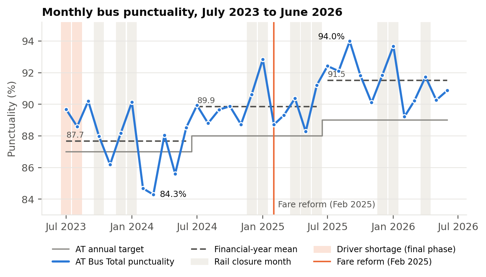

# Auckland Bus Punctuality: What Really Moves the Monthly Number

Author: Eddy Jiang · Auckland, 2026

Auckland Transport (AT) reports one headline figure for bus punctuality each month. This project asks a simple question with a practical use: when that number goes up or down, how much of the change comes from a real event or policy, and how much would have happened anyway because of the season, passenger demand or the longer-term trend?

The analysis uses **only public data published by Auckland Transport** on its own website, covers **36 months (July 2023 to June 2026)** and a route panel of **17,704 route-months across 562 routes**, and is fully reproducible in Google Colab. A final check recomputes **68 key numbers in the report, and all 68 pass**.

## Key findings

| # | Finding | Evidence |
|---|---------|----------|
| 1 | **Passenger demand drives most of the monthly pattern.** Each extra boarding per service hour goes with 0.69 pp lower punctuality in the same month. | p < .001; adjusted R² falls from 0.765 to 0.353 without ridership; within a route the effect is −0.28 pp |
| 2 | **A headline policy effect disappears once the trend is controlled.** A model without the trend credits the February 2025 fare reform with +3.05 pp. With the trend included the effect is +0.72 pp and not significant. | p < .001 without trend vs p = .377 with trend; the improvement is real, but the data cannot attribute it to the reform |
| 3 | **Event information did not improve forecasts.** A seasonal SARIMA model using only past punctuality beat the full regression in 12 rolling one-month-ahead forecasts. | RMSE 0.98 vs 1.37 pp (Diebold–Mariano p = .224, so not proven better) |
| 4 | **The network average hides large differences.** School services average 73.2%, and South Auckland is the least punctual area on scheduled routes at 86.6%. | All-route area spread 16.3 pp vs 4.5 pp on scheduled routes |
| 5 | **A change in measurement definition matters.** The old first-stop measure averaged 96.9% and the new measure 87.9%, a 9.0 pp gap. | Data-quality audit across AT publications |

## Why it matters

The core question is the same one used to review any business case or performance claim: **would the benefit have happened without the intervention?** The project shows how a trend-free comparison can overstate an effect, and how a trend- and calendar-controlled check with confidence intervals and minimum detectable effects gives a more honest answer.

## Recommendations for AT reporting

1. **Trend-controlled attribution:** check any claimed improvement against the trend and calendar before crediting a policy.
2. **Ridership reporting:** publish boardings per service hour beside punctuality by route and area.
3. **Seasonal expectation band:** treat a month as changed only when it falls outside a seasonal band (the seasonal swing is about 5.8 pp).
4. **Area and service-level reporting:** report School services and service areas separately from the Bus Total.
5. **Release metadata:** state the definition, route population and excluded days with each release.
6. **Separate contractual and customer measures:** add a customer measure with interim stops at key interchanges.

## Methods

- **Data audit:** missing values, duplicates, ten-route rule, definition break, cross-release consistency, suppressed cells (434 route-months)
- **Interrupted time-series regression** with HAC standard errors, confidence intervals, VIF, minimum detectable effects and joint F tests
- **SARIMA** model selection by AIC and rolling one-step-ahead forecasts, compared with the Diebold–Mariano test
- **STL decomposition** of trend, seasonal pattern and remainder
- **14 robustness specifications** and four alternative shapes for the fare effect
- **Route panel** with within-route fixed effects, difference-in-differences for rail closures, and a bootstrap mediation test
- **Triangulation** with the Office of the Auditor-General (2025) area figures

Tools: Python (pandas, statsmodels, SciPy, matplotlib) in Google Colab.

## Repository contents

| Path | Description |
|------|-------------|
| `report/Auckland_Bus_Punctuality_Report.pdf` | Findings and solutions (20 pages): background, analysis model, results and recommendations |
| `report/One_Page_Summary.pdf` | One-page summary for non-technical readers |
| `notebooks/ABPEM_Colab.ipynb` | Colab notebook with all outputs, from raw files to the final 68-number check |
| `src/ABPEM_Colab.py` | The same analysis as a single Python script |
| `figures/` | Charts produced by the notebook |

## Data source

All nine data files are public Excel workbooks published by **Auckland Transport** on its website:
[How many people are taking buses, trains and ferries](https://at.govt.nz/about-us/reports-publications/how-many-people-are-taking-buses-trains-and-ferries)

- Monthly punctuality and reliability: 2023 to 2024, 2024 to 2025, and to June 2026
- Hourly bus boardings: 2023 to 2024, 2024 to 2025, and to June 2026
- Bus performance reports: January to December 2023, January to December 2024, and January to March 2025

The raw files are not stored in this repository. Please download them from the AT page above. The event register (`event_ecode.xlsx`, dates of driver shortages, rail closures, the fare reform and network changes) was compiled for this study from dated public sources. It and the full report are available from the author on request. The notebook checks the SHA-256 hash of each file against the version analysed (report Appendix E), so a newer AT release that has been revised will be flagged.

No field in the derived datasets identifies a person, driver, vehicle or operator.

## How to reproduce

1. Open `notebooks/ABPEM_Colab.ipynb` in Google Colab.
2. Choose **Runtime → Run all**.
3. When prompted, upload the 10 files (9 AT workbooks and the event register).
4. The run takes about one minute. The last cell prints PASS or FAIL for each of the 68 reported numbers.

The report was produced with statsmodels 0.15.0, which the first cell installs.

## Contact

Eddy Jiang · Auckland, New Zealand · [github.com/EddyKinNZ](https://github.com/EddyKinNZ)
